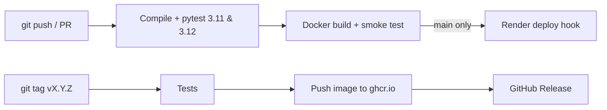

# CI/CD, Containers, Monitoring, Releases and Deployment

## 1. What is in place
| Area | Files | What it does |
|---|---|---|
| CI | `.github/workflows/ci.yml` | On every push and pull request: compile check, full pytest suite on Python 3.11 and 3.12, Docker build, container smoke test (`/health`, `/ready`) |
| CD | job `deploy` in `ci.yml` | After tests pass on `main`, calls the Render deploy hook (only if the secret exists) |
| Release | `.github/workflows/release.yml`, `VERSION`, `CHANGELOG.md` | Tag `vX.Y.Z` → tests → Docker image on GitHub Container Registry → GitHub Release with notes from the changelog |
| Containers | `Dockerfile`, `docker-compose.yml`, `.dockerignore` | Slim Python 3.11 image, non-root user, healthcheck, data volumes |
| Monitoring | `backend/monitoring.py` | `/health`, `/ready`, `/metrics`, `/api/version`, request IDs, request log lines, error logging, optional Sentry |
| Dependencies | `.github/dependabot.yml` | Weekly pip, monthly Actions/Docker update PRs |
| Config | `.env.example`, `render.yaml` | Documented environment variables; Render service definition |

## 2. Pipeline


## 3. Monitoring endpoints
| Endpoint | Use |
|---|---|
| `GET /health` | Liveness. Render and Docker use it. Returns version and uptime |
| `GET /ready` | Readiness (checks the database). 503 if not ready |
| `GET /api/version` | Version and git commit |
| `GET /metrics` | Prometheus text: requests by route/status, latency sum and count, unhandled exceptions, uptime. Set `METRICS_TOKEN` to protect it (`/metrics?token=...`) |

Logs look like `rid=ab12cd34ef56 POST /api/analyze/start -> 200 85ms`. The same id is returned in the `X-Request-ID` header, so a user's error can be found in the logs. Set `LOG_LEVEL=DEBUG` for more detail. For error alerts by email, create a free Sentry project, `pip install sentry-sdk`, and set `SENTRY_DSN`. For uptime alerts, point a free monitor (UptimeRobot, Better Stack) at `https://<your-app>/health`.

## 4. Run with Docker locally
```powershell
copy .env.example .env      # fill FIREBASE_SERVICE_ACCOUNT_JSON (one line) and APP_SECRET_KEY
docker compose up --build   # http://localhost:8000
curl http://localhost:8000/health
```
Data (SQLite, uploads, reports) lives in Docker volumes and survives restarts.

The image leaves out the optional `sentence-transformers`, `torch` and `numpy` packages (about 2 GB). The app detects this and uses TF-IDF similarity instead. Remove the `grep` filter in the `Dockerfile` if you want them.

## 5. Deployment — step by step (Render, free tier)

### Before you start
1. Make sure the code is on GitHub (`MeghaScripts/ResearchLens-AI`) and the CI badge/run is green.
2. Have your Firebase service-account JSON ready (Firebase console → Project settings → Service accounts → Generate new private key). **Never commit it**; `serviceAccountKey.json` must not be in the repository.
3. In the Firebase console → Authentication → Settings → Authorized domains, add your Render domain (`<name>.onrender.com`).

### Push the changes
```powershell
git checkout -b devops-ci-cd
git add .github Dockerfile docker-compose.yml .dockerignore .env.example VERSION CHANGELOG.md render.yaml docs backend/monitoring.py backend/app.py backend/tests
git commit -m "Add CI/CD, Docker, monitoring, versioning and docs"
git push -u origin devops-ci-cd
```
Open a pull request on GitHub. The **CI** workflow runs; merge when it is green.

### Create the Render service
1. render.com → New → **Blueprint** → choose the repository (it reads `render.yaml`), or New → Web Service with the same settings.
2. In the service's Environment tab set:
   - `FIREBASE_SERVICE_ACCOUNT_JSON` = the whole JSON on one line
   - `APP_SECRET_KEY` (generated automatically by the blueprint)
   - optional: `SENTRY_DSN`, `METRICS_TOKEN`, `LOG_LEVEL`
3. Deploy. Render builds, then starts gunicorn and checks `/health`.
4. Open `https://<name>.onrender.com/health` — you should see `{"status":"ok",...}`; then `/login`.

### Continuous deployment from GitHub Actions (optional)
Render → service → Settings → **Deploy Hook** → copy the URL → GitHub repo → Settings → Secrets and variables → Actions → new secret `RENDER_DEPLOY_HOOK_URL`. From then on a push to `main` deploys only after tests and the Docker smoke test pass. (Turn off Render's own "Auto-Deploy" if you want only this path.)

### Release a version
1. Update `CHANGELOG.md` and `VERSION` (e.g. `1.1.0`), commit and push to `main`.
2. `git tag v1.1.0` then `git push origin v1.1.0`.
3. The Release workflow publishes `ghcr.io/<owner>/researchlens-ai:v1.1.0` and a GitHub Release.

## 6. Production checklist
- [ ] CI green on `main`
- [ ] `FIREBASE_SERVICE_ACCOUNT_JSON` and `APP_SECRET_KEY` set in Render (not in git)
- [ ] Render domain added to Firebase authorized domains
- [ ] `/health` and `/ready` return 200 after deploy; login and one analysis work
- [ ] Uptime monitor on `/health`
- [ ] `.env`, `*.db`, `serviceAccountKey.json` not committed (check `git ls-files`)

## 7. Known limits of the free tier
- **Data is not permanent.** Render's free web service has no persistent disk: the SQLite database, uploads and reports are lost on redeploy or restart. For real use, add a Render persistent disk (paid) and set `DB_PATH`/`STORAGE_BASE` to it, or move to PostgreSQL.
- The service sleeps after about 15 minutes idle; the first request wakes it (30–60 s).
- 512 MB RAM: keep the heavy ML packages out (the build command already does).
- Groq and scholarly-API rate limits apply per user key / IP.
- Background jobs and the watch-topic scheduler run inside the web process (2 gunicorn workers); with several workers, in-progress job status is per process. If you see "job not found" while polling, run `--workers 1 --threads 8`.
