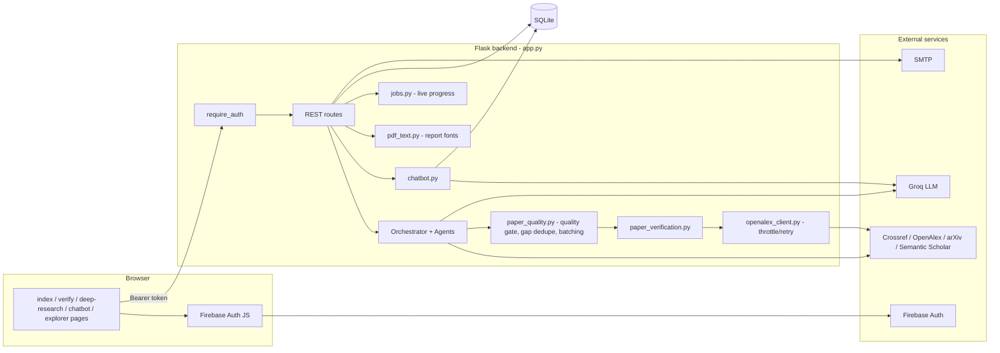
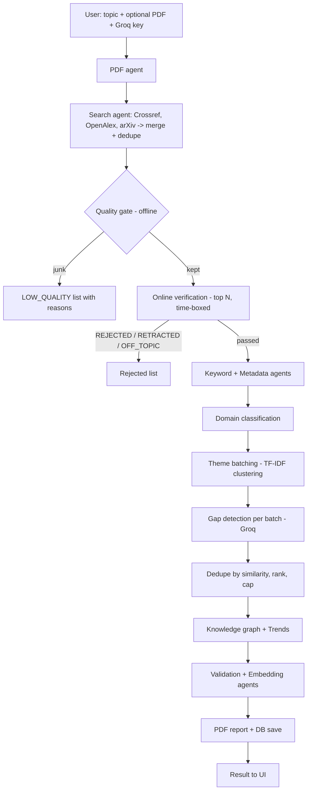
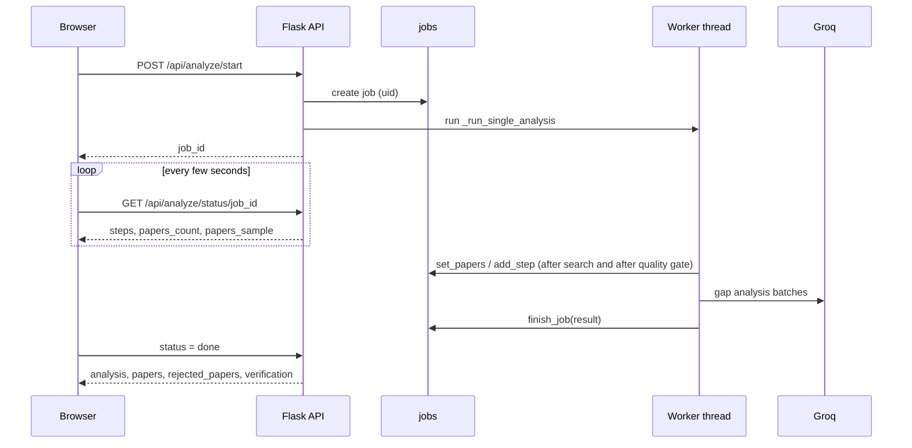
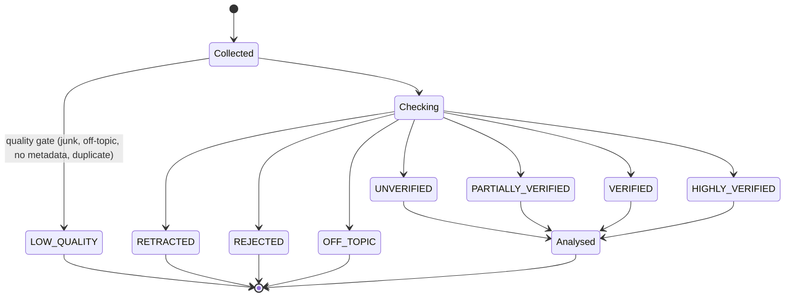
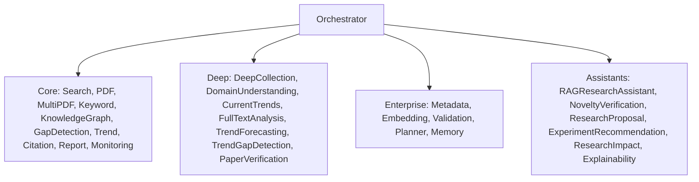
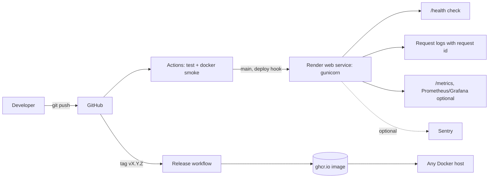

# Design Document — ResearchLens AI

All diagrams are Mermaid (render on GitHub / VS Code / mermaid.live).

## 1. System architecture

## 2. Standard analysis pipeline (data flow)

## 3. Sequence: starting an analysis with live progress

## 4. Paper verification state machine

## 5. Agents

Each agent extends `BaseAgent` and returns an `AgentResult` (success, data, error); the orchestrator records a trace per step.

## 6. API overview
| Area | Routes |
|---|---|
| Pages | `/`, `/index.html`, `/login`, `/verify`, `/deep-research`, `/explorer`, `/chatbot` |
| Analysis | `POST /api/analyze`, `/api/analyze/start`, `GET /api/analyze/status/<id>`, `POST /api/analyze-multi`, `/api/deep-research`, `GET /api/deep-research/sources` |
| Verification | `GET /api/verification-runs`, `/api/verification-runs/<id>`, `/api/verification-runs/<id>/papers`, `/api/verification-history` |
| Assistants | `/api/agents/{ask,novelty,proposal,experiment,impact,explain,plan}`, `/api/graph-qa`, `/api/thesis-check`, `/api/related-work`, `/api/gap-funding`, `/api/gap-litreview` |
| Export | `/api/export/bibtex`, `/api/gap-brief/pdf`, `/api/download/<file>` |
| Monitoring | `/api/watch`, `/api/unwatch`, `/api/watched-topics`, `/api/check-now/<id>` |
| Workspaces | `/api/workspace/{create,join}`, `/api/workspace/<code>/{contribute,library,dashboard,gap/assign,gap/assignments,gap/comment,gap/comments}` |
| Community | `/api/community/gaps` (+ share, upvote, delete), `/api/gap-feedback`, `/api/eval/accuracy-summary` |
| Chatbot | `/api/chatbot/*` (documents, conversations, messages, notes, tools) |

## 7. Database (ER diagram)

```mermaid
erDiagram
  analyses ||--o{ gap_feedback : receives
  analyses ||--o{ public_gaps : shared_as
  workspaces ||--o{ workspace_members : has
  workspaces ||--o{ workspace_papers : holds
  workspaces ||--o{ gap_assignments : tracks
  workspaces ||--o{ gap_comments : discusses
  watched_topics ||--o{ topic_snapshots : snapshots
  verification_runs ||--o{ verified_papers : contains
  cb_documents ||--o{ cb_pages : has
  cb_documents ||--o{ cb_chunks : indexed_into
  cb_conversations ||--o{ cb_messages : contains
  cb_documents ||--o{ cb_notes : annotated_by
  domains ||--o{ venue_domains : maps
  venues ||--o{ venue_domains : maps
  domains ||--o{ domain_publishers : maps
  publishers ||--o{ domain_publishers : maps
  domains ||--o{ domain_societies : maps
  societies ||--o{ domain_societies : maps
```

Other tables: `generated_files`, `query_domain_classifications`. Every user-owned table carries an owner/user id and every query filters on it.

## 8. Key design decisions
| Decision | Reason |
|---|---|
| Agent-per-task with an orchestrator | Steps can be run, traced, replaced and run in parallel independently |
| Offline quality gate before network verification | Network checks are partial and time-boxed; junk must never depend on them |
| Theme batching + similarity de-duplication | A single huge prompt yields few gaps; coherent batches yield more distinct, specific gaps |
| SQLite | Zero-setup for a student project; single-file backup |
| Client-supplied Groq key | No shared API cost; key not stored by the chatbot |
| TF-IDF retrieval for chatbot | No extra model or vector service required; fast and explainable |
| Throttled OpenAlex client with 429 retry | Prevents rate-limit floods and keeps verification working |
| Bundled DejaVu Sans Condensed fonts in PDF | Avoids missing-glyph boxes for non-Latin-1 characters |

## 9. Deployment and operations view

Operational endpoints are public except `/metrics`, which can be protected with `METRICS_TOKEN`.

## 10. Security design
Firebase token verification on each request; per-user scoping; upload validation and generated file names; Markdown sanitised with DOMPurify; Mermaid strict mode; rate limiting; secrets in environment variables (`.env` is git-ignored).
