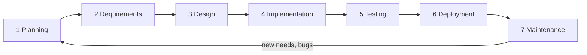
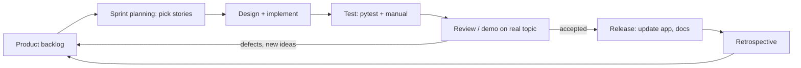

# SDLC and Agile Process — ResearchLens AI

This document describes the full software development life cycle (SDLC) of the project and how the **Agile (iterative, Scrum-style)** model was applied. The project is developed by one student (Megha M) with an AI coding assistant, so Scrum is *adapted*, not followed by the book; the adaptations are stated in §4.

> The sprint history in §5 is reconstructed from the project's features and change log (`Steps_taken_to_execute.txt`, `SECURITY_FIXES.md`, `AGENTS.md`, git history). Replace dates and sprint boundaries with your own if they differ.

## 1. The SDLC phases and where each lives in this project



| # | Phase | Activities in this project | Artifacts |
|---|---|---|---|
| 1 | Planning | Define the problem (finding research gaps is slow and manual), decide scope, pick the stack (Flask, SQLite, Firebase, Groq), list risks (API rate limits, junk papers, LLM errors) | Product backlog (§5), `AGENTS.md` |
| 2 | Requirements | Gather needs from the student/researcher point of view; write user stories and acceptance criteria; later formalise as SRS | `docs/SRS.md` |
| 3 | Design | Agent-per-task architecture, REST API, SQLite schema, verification states, security design | `docs/DESIGN.md` |
| 4 | Implementation | Backend (`backend/app.py`, `agents/`, `paper_verification.py`, `chatbot.py`, `paper_quality.py`), frontend pages (`frontend/`) built feature by feature | source code, git commits |
| 5 | Testing | Automated pytest suites, manual test cases, browser checks; bugs fixed with regression tests | `backend/tests/`, `docs/TEST_PLAN.md` |
| 6 | Deployment | Render web service with gunicorn; environment variables for secrets; health check on `/` | `render.yaml`, `DEPLOY.md`, `requirements.txt` |
| 7 | Maintenance | Security fixes, rate-limit handling, PDF and quality fixes, tuning of gap counts, dependency updates | `SECURITY_FIXES.md`, `Steps_taken_to_execute.txt` |

### Deliverables per phase (what to show in a viva)
| Phase | Evidence |
|---|---|
| Planning | Backlog table §5.1, risk table in `TEST_PLAN.md` §12 |
| Requirements | FR/NFR tables in `SRS.md` |
| Design | 6 diagrams in `DESIGN.md` |
| Implementation | Repository structure, agents, API list |
| Testing | 81+ automated tests, test cases TC-01–TC-12 |
| Deployment | `render.yaml`, `DEPLOY.md` |
| Maintenance | Change log and the defect table in §6 |

## 2. Why Agile
| Reason | In this project |
|---|---|
| Requirements kept changing | New needs appeared while using the tool (verification, chatbot, junk-paper filtering, more gaps) |
| Working software early | The core "topic → papers → gaps" flow ran in the first iteration and was extended |
| Fast feedback | Each iteration was run on real topics (e.g. "AI", 500 papers) and screenshots of problems drove the next fix |
| External uncertainty | LLM quality and API limits cannot be known upfront, so short experiments beat long planning |
| Small team | One developer cannot afford heavy up-front documents; documents were completed once the design stabilised |

A pure Waterfall plan would have fixed the feature list before anyone saw how the LLM and the scholarly APIs behaved.

## 3. The Agile cycle used



### 3.1 Roles
| Scrum role | Who in this project |
|---|---|
| Product Owner | Megha M — decides priorities and accepts or rejects results |
| Scrum Master / Developer | Megha M, with an AI assistant (Claude) used as a pair programmer for code, tests and documents |
| Stakeholders / users | Fellow students, guide/faculty, researchers who try the tool |

### 3.2 Artifacts
| Artifact | Where |
|---|---|
| Product backlog | §5.1 |
| Sprint backlog | one row per sprint in §5.2 |
| Increment | the working application after each sprint |
| Definition of Done | §3.3 |

### 3.3 Definition of Done
A story is done when:
1. It works on a real topic in the running app.
2. Automated tests exist and pass (or a manual test case is recorded).
3. Existing tests still pass (no new regressions).
4. No secrets are hard-coded; per-user data isolation is preserved.
5. Configuration is documented (environment variable, default).
6. Docs updated (`AGENTS.md`, SRS/DESIGN/TEST_PLAN when behaviour changes).

### 3.4 Ceremonies (adapted for one developer)
| Ceremony | How it was done |
|---|---|
| Sprint planning | Choose the next backlog items; write the request/specification (e.g. the chatbot master prompt) |
| Daily stand-up | Replaced by a short written status per work session |
| Sprint review | Run the app on a real topic, inspect screenshots, accept or reject |
| Retrospective | Note what went wrong (e.g. junk papers reached the AI) and add it to the backlog |
| Backlog refinement | Split large items (e.g. "improve gaps") into specific stories |

## 4. Where this differs from textbook Scrum (honest assessment)
| Textbook | This project |
|---|---|
| Cross-functional team | One developer plus an AI assistant |
| Fixed-length sprints (2 weeks) | Variable-length iterations driven by feedback |
| Burndown charts, velocity | Not tracked |
| Continuous integration | Implemented in iteration 10 (GitHub Actions) |
| Daily stand-up | Not applicable |

The method is therefore best described as **iterative and incremental Agile with Scrum-style backlog, review and retrospective**.

## 5. Backlog and iterations

### 5.1 Product backlog (user stories)
Priority H/M/L; status Done or Planned.

| ID | User story | Pri | Status | SRS |
|---|---|---|---|---|
| US-1 | As a researcher I want to enter a topic and get papers from several sources so that I see the literature | H | Done | FR-3 |
| US-2 | As a researcher I want research gaps with evidence so that I can choose a research direction | H | Done | FR-10 |
| US-3 | As a user I want to sign in so that my work is private | H | Done | FR-1, FR-2 |
| US-4 | As a user I want to upload my own paper so that gaps relate to it | M | Done | FR-5 |
| US-5 | As a user I want to choose publishers/societies/venues so that results come from trusted places | M | Done | FR-4 |
| US-6 | As a user I want deep research with trends and full text so that analysis is richer | M | Done | FR-14 |
| US-7 | As a user I want papers verified so that fake or retracted work is excluded | H | Done | FR-7–9 |
| US-8 | As a team I want shared workspaces with assignments and comments | M | Done | FR-23, FR-24 |
| US-9 | As a user I want to chat with a paper and get cited answers, notes, mind maps, quizzes | H | Done | FR-19–22 |
| US-10 | As a user I want a readable PDF report | H | Done | FR-15 |
| US-11 | As a user I want OpenAlex rate-limit errors handled so that verification keeps working | H | Done | NFR-2 |
| US-12 | As a user I want junk papers (e.g. "sdfgd", reviewer acknowledgments) removed before analysis | H | Done | FR-6 |
| US-13 | As a user I want far more than ~10 gaps from 500 papers | H | Done | FR-11 |
| US-14 | As a user I want live progress that shows only real papers | M | Done | FR-12 |
| US-15 | As a user I want to watch a topic and be emailed on new gaps | L | Done | FR-26 |
| US-16 | As a maintainer I want tests to run automatically on every push (CI) | M | Done | NFR-5 |
| US-17 | As a maintainer I want a Dockerfile, `/health` endpoint and monitoring | M | Done | NFR-6 |
| US-18 | As a user I want embedding-based retrieval and OCR in the chatbot | L | Planned | – |
| US-19 | As a maintainer I want the failing `test_routes_e2e.py` stub fixed | M | Done |
| US-20 | As a maintainer I want versioned, automated releases (tag → image + GitHub Release) | M | Done | NFR-5 |

### 5.2 Iterations (reconstructed)
| Iteration | Goal | Stories | Increment delivered | Review outcome |
|---|---|---|---|---|
| 1 | Core pipeline | US-1, US-2, US-3, US-10 (basic) | Topic → papers → gaps → PDF, with login | Works; gap quality and source trust need work |
| 2 | Context and scope | US-4, US-5 | PDF upload; publication scope selector | Accepted |
| 3 | Depth | US-6, US-15 | Deep research mode, trends, topic watching | Accepted; slow — add speed presets |
| 4 | Trust | US-7 | Three-level paper verification, verification history page | Accepted; later found to let junk through |
| 5 | Collaboration | US-8 | Workspaces, assignments, comments, community board | Accepted |
| 6 | Research Chatbot | US-9 | `/chatbot`: upload, RAG answers with citations, notes, mind map, quizzes (12 tests) | Accepted after fixes (blank flowcharts, node clicks) |
| 7 | Hardening | US-11, US-10 | OpenAlex throttle/retry; PDF fonts (no ■ boxes) | Accepted (21 tests) |
| 8 | Quality | US-12, US-13, US-14 | Quality gate, theme batching, similarity dedupe, live-list refresh | Accepted; second pass added stricter junk rules after review screenshots |
| 9 | Process | documentation | SRS, design, test plan, this document | Accepted |
| 10 | DevOps | US-16, US-17, US-19, US-20 | GitHub Actions CI/CD, Dockerfile + compose, `/health` `/ready` `/metrics`, VERSION + CHANGELOG + release workflow, all 102 tests green | Ready to deploy |

### 5.3 Example of the feedback loop (iteration 8)
```mermaid
sequenceDiagram
  participant U as Product Owner
  participant D as Developer
  U->>D: Screenshot: junk papers in workspace; 500 papers gave only ~10 gaps
  D->>D: Diagnose root causes (only REJECTED removed; top-40 verified; cap 15; prefix dedupe)
  D->>U: Increment 1: quality gate + themed batches + dedupe (tests pass)
  U->>D: Review on real topic "AI": junk titles still listed
  D->>D: Find live list built before gate
  D->>U: Increment 2: refresh live list, stricter junk rules
  U->>D: Accept; ask for SRS/design/test plan
```

## 6. Quality practices inside the Agile loop
| Practice | Evidence |
|---|---|
| Test with each increment | `test_chatbot.py`, `test_openalex_and_pdf.py`, `test_quality_and_gaps.py` |
| Regression tests for every bug | Each defect below has a test |
| Refactor safely | Small patches to `app.py`, full suite re-run |
| Security review | `SECURITY_FIXES.md`; per-user scoping tests |
| Honest limits documented | SRS §7, TEST_PLAN §11 |

| Defect found in review | Fix | Regression test |
|---|---|---|
| Blank flowcharts (sanitizer stripped `-->`) | Keep Mermaid source in memory | chatbot diagram routing |
| ■ boxes in PDF | Bundled DejaVu Sans Condensed | PDF rendering test |
| OpenAlex 429 floods | Throttled client with retry | OpenAlex client tests |
| Junk papers analysed | Offline quality gate | junk title parametrised tests |
| ~10 gaps from 500 papers | Theme batching, similarity dedupe, cap 40 | 500-paper fake-Groq test |
| Junk visible in live list | Refresh list after gate | live-progress test |

## 7. DevOps in the Agile loop
Continuous integration and delivery close the loop from commit to running service (details in [CICD_DEPLOYMENT.md](CICD_DEPLOYMENT.md)):

```mermaid
flowchart LR
  C[Commit / PR] --> CI[GitHub Actions: compile + pytest on Python 3.11 and 3.12]
  CI --> DK[Docker build + /health smoke test]
  DK --> CD[Deploy hook -> Render]
  CD --> MON[/health /ready /metrics + logs]
  MON -->|incident, feedback| B[Backlog]
  TAG[git tag vX.Y.Z] --> REL[Release workflow: tests, image to GHCR, GitHub Release]
```

Remaining ideas: alerting rules on `/metrics`, staging environment, automated database backups.

## 8. Summary for viva
- **SDLC:** all seven phases are present and documented (§1).
- **Model:** Agile — iterative increments driven by the Product Owner's review on real topics, a prioritised backlog, a Definition of Done, review and retrospective each iteration.
- **Adaptation:** single developer with an AI pair programmer; no fixed sprint length; no velocity tracking. CI/CD and releases are automated.
- **Evidence:** backlog (§5.1), iteration table (§5.2), tests, change log, deployment files.
